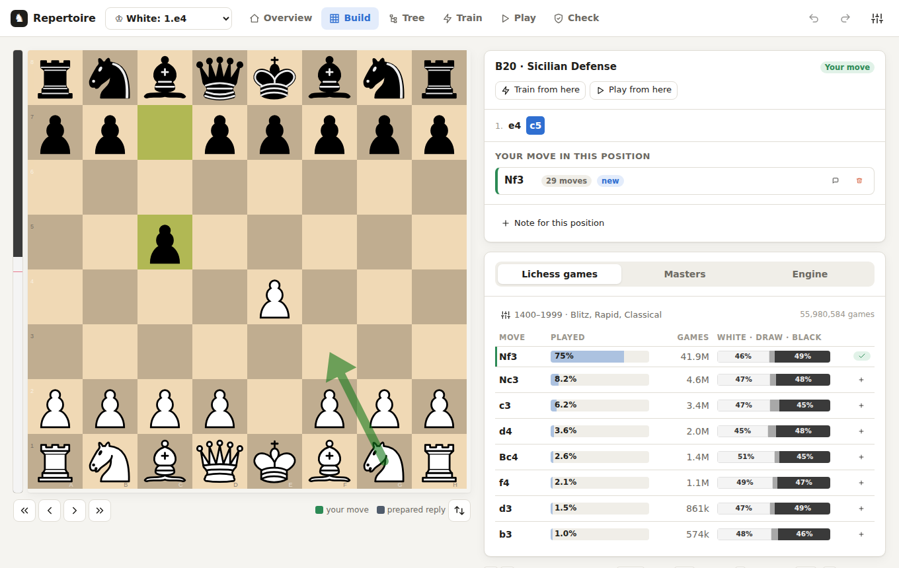
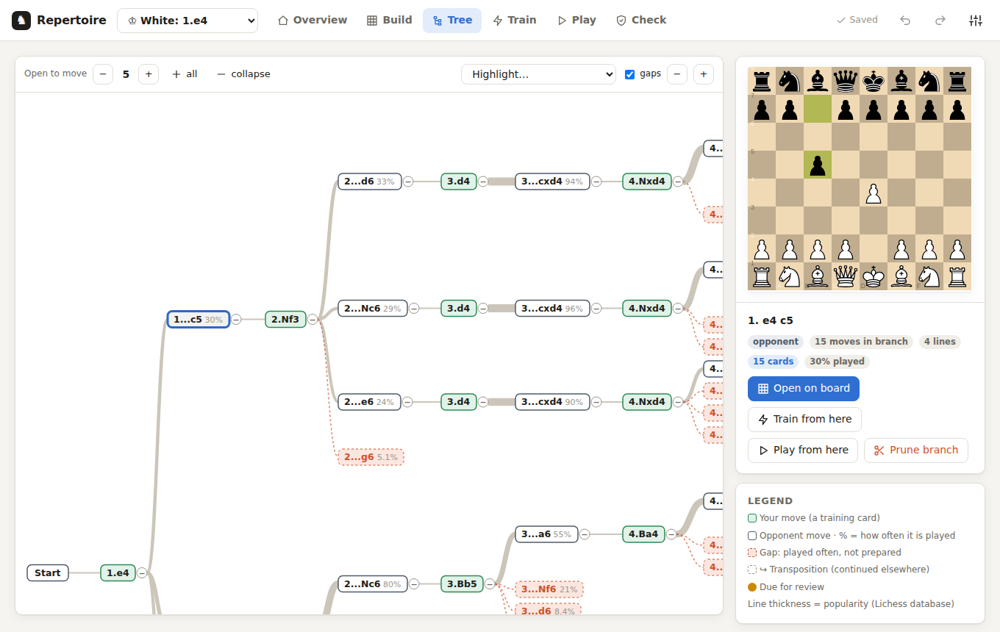
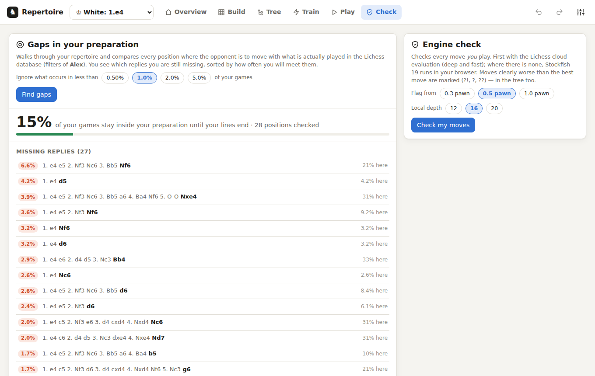
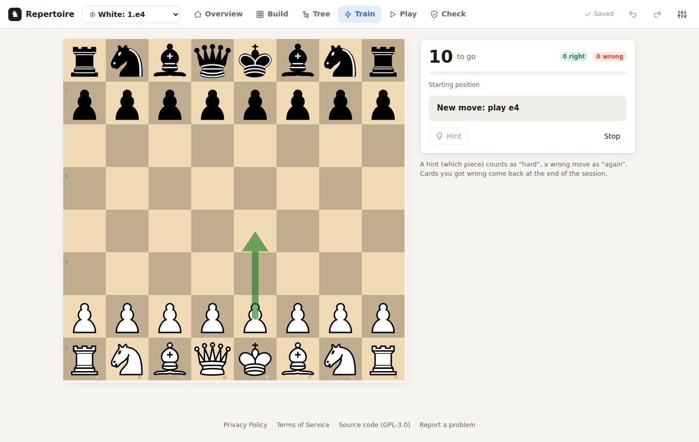
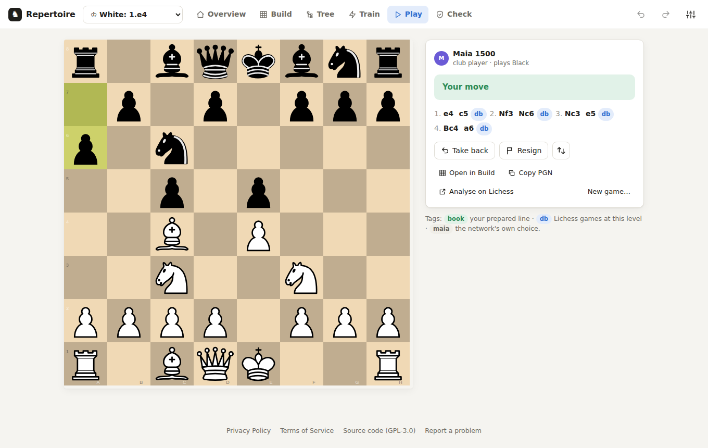

# Repertoire — build, check and train your chess openings

> **Repertoire 1 is now a legacy version.** It remains available and usable at [the original app](https://zeddyfree-art.github.io/chess/), but it will receive no further feature updates. The actively maintained successor is **[Repertoire 2](https://zeddyfree-art.github.io/repertoire2/)**. The apps have separate data and Google Drive storage; moving to Repertoire 2 is optional and is not automatic.

A web app in the spirit of Chessbook, but with **no move limit**, **several players** per device, **sync
across devices** through your own Google Drive, and a **human-like practice opponent**. Build opening
repertoires, see all branches at a glance, prune what you don't need, check your moves with an engine and
against what people at your level actually play (Lichess database), train with spaced repetition (FSRS),
and play practice games from any position. Bring in the **games you played** (Lichess or PGN): they are analysed on
your device, and the mistakes you choose become cards in your own deck of mistakes.

Live: <https://zeddyfree-art.github.io/chess/> · [About](https://zeddyfree-art.github.io/chess/#about) · [Privacy Policy](https://zeddyfree-art.github.io/chess/privacy.html) · [Terms of Service](https://zeddyfree-art.github.io/chess/terms.html)



| | |
| --- | --- |
|  |  |
| **Tree**: the whole repertoire; red dashed nodes are replies people play that you have not prepared. | **Check**: missing replies sorted by how often you will meet them, plus a coverage percentage. |
|  |  |
| **Train**: today's session over all your repertoires and mistake cards; every move you play is a card. | **Play**: a practice game against Maia-3; move tags show where the opponent's moves came from. |

*The screenshots use a demo repertoire and sample database percentages, not live Lichess numbers.*

**What's new and feedback**: after an update the app shows once what changed (all versions are on the About page; the list is `src/lib/changelog.ts`, with the version in `package.json`), and *Send feedback* at the bottom of every screen opens an e-mail with the version and your device filled in.

**Board colours**: Brown (Lichess), Green, Blue, Slate, Graphite or Iris (from Rookahead, GPL-3.0), or one of Lichess' picture boards — Wood, Maple, Marble, Blue marble, Leather, Olive and ICC (AGPL-3.0, see `public/boards/README.md`) — in *Settings → Sound and display*, for every board in the app.

**Install it as an app**: in Chrome, Edge or on Android, *Settings → Install the app* (or the install icon in the address bar); on an iPhone or iPad, Share → *Add to Home Screen*. The installed app has its own icon and window and starts without a network (a service worker keeps the app's files; building, training and playing against Maia work offline, the Lichess database, game imports and syncing need a connection). Updates arrive by themselves. The app also asks the browser to keep its storage for good (*persistent storage*), so it is not cleared when the device runs low on space; Settings shows whether it is (Chrome, Edge and Safari decide by themselves, usually yes for an installed app; Firefox asks you, through the *Keep my data* button).

## What's inside

| Screen | What you do there |
| --- | --- |
| **Overview** | Today's training at the top — "Today: 23 reviews · 4 mistake cards · 10 new moves" — with **Train (N)**, which starts that session at once; below, the active player's repertoires with their size and what is due. Each is marked **In play** (you play it now: your games are checked against it) or **Study** (you train it, but your games are not checked against it); click the label to switch. Drag a card by the handle at its top (═) to change the order (mouse or finger; or focus the handle and use the arrow keys); the order is saved per player and synced, and the repertoire list in the top bar follows it. Sizes are counted like books and PGN do: one **move** is White's move plus Black's reply (1.e4 e5 is one move); hover a number for the half-moves, your own moves and line lengths. Each card's **⋯** menu has **Pause training** (or **Resume training**), **Download as PGN**, **Import a PGN** (add its lines, or replace the repertoire with it; see below) and **Delete** (with confirmation and an Undo). |
| **Build** | Board plus the current line. Moves you play are a *proposal* (dashed blue) until you **Save** (Enter) or **Discard** (Esc). Next to it: your prepared moves in this position (○ White / ● Black, with number of follow-up moves, comments, ★ main move, delete), a note per position, and tabs **Lichess games**, **Masters** and **Engine**. Arrows on the board: your prepared moves in white or black, and **gaps in orange-red** — the opponent's replies that the database table marks as *gap* (played in 5% or more of its games, while you prepared other replies), thicker the more often they are played (shown with the Lichess games or Masters tab open). Under the database table: about how often you reach this position in your games (the opponent's shares along this move order), and a gap's tooltip gives both measures — the share here and the share of all your games, which is what the Check counts. **Train from here** and **Play from here** start from the position on the board. Imported comments and arrows/circles show here; you can draw your own (see below). |
| **Tree** | The whole repertoire as a diagram. Green = your move, outlined = opponent move with how often it is played; line thickness = popularity; red dashed nodes = **gaps** (played often, not prepared). Collapse/expand per branch or to a depth, highlight due / dubious / rare moves. **Left to right or top down** (top down reads better on a phone and is the default there). The layout is compact: each branch sits as close to its neighbours as their shapes allow (a narrow branch fits next to a wide one wherever they do not meet), every box takes only its own width, and only levels with an opening name make room for it. **Zoom** with the magnifier buttons, Ctrl + scroll, a trackpad pinch or two fingers on a touch screen; drag (or one finger) to move around; *fit* shows the whole tree. **Opening names** label each branch where it becomes a (more specific) named opening — "Sicilian Defense", then "Najdorf Variation" — from the list Lichess uses (lichess-org/chess-openings, public domain, built into the app so it works without Lichess); the same names appear in Build, training, practice games and game reviews, and can be switched off (Settings, or *names* in the Tree). Select a node to open it, train or play from it, or **Prune branch** (Delete) — you see beforehand how many moves and cards disappear, and everything can be undone (Ctrl+Z). |
| **Train** | **Today** (the first tab, and **Train (N)** on the Overview) is one session for everything you train: first the reviews due in each repertoire (one repertoire after the other, each in the order of its tree; paused repertoires are left out), then your mistake cards (due ones, then new ones), then new moves, repertoire by repertoire in your Overview order. The Overview, the Train tab's badge and the session show the same number, and one summary closes it. **Include my mistake cards** (on the Today card) takes your mistake cards into the session or leaves them to their own tab. Under *Settings*: per repertoire how many new moves a session adds (0 for reviews only) and whole lines or single cards, and how many new mistake cards — kept with each repertoire (and the player, for mistake cards), the same on all your devices. Next to it, a tab per repertoire (only that one, with two clear choices: **Train (N)**, reviews and new moves that become cards, and **Practice all lines**, see below; pause, reset and drilling a branch in its **⋯** menu; under *Settings* this repertoire's depth, new moves per session and whole lines) and **My mistakes** (positions from your own games, see below). FSRS spaced repetition: each move you play is a card. **Moves you keep missing**: a card missed four times or more after you had learned it (a "leech", as Anki calls it) offers three other ways than more reviews — a note on the position, playing it against Maia, or simplifying the line in Build — and the repertoire tab lists them. With **Play whole lines** ticked, a review plays whole lines instead of single cards: you play all your moves of each line (from the start, or from the branch you train), the opponent's are played for you, and the app picks lines that together cover every move due today, few of them (it follows the branches with the most due moves). Due moves are graded as usual; a move that is not due only counts when you get it wrong (it comes back soon); new moves are shown first and their lines come back without help at the end of the session, which is when they are graded. **Train up to move N** (per repertoire, synced) learns a wide repertoire breadth-first: reviews, new moves and drills stop at that move (practice does not) (a position counts at its shortest move order); deeper cards keep their schedule and come back when you go deeper, and the app suggests going one move deeper once everything up to there is learned. **Pause training** takes a repertoire out of the reviews (it no longer counts as due) until you resume; **Reset progress** makes its moves new again — or those of one branch when you train from there — and can be undone, also after syncing. New moves are shown first and quizzed again later in the session, with everything the author wrote around them: the comment on the opponent's move before it, the note on the position, and the comment on your move. **Each card asks for its own move**: where you have two moves prepared, playing the other one is not wrong but does not pass the card — it says so and waits for the move the card is about. **Time to read**: when you find the move, the session goes straight on, and the comment on your move (and the note on the position) stays in view on the next card until you answer it; **after a mistake you play it again right away**: first the right move with the arrow, then once more from memory without it — the card goes on only when you find it yourself — and it comes back once more at the end of the session, where a mistake is again repeated until you play it right (in whole lines too: the move again from memory, and the lines of the moves you missed once more at the end). In whole lines and practice the comment on your move stays in view until your next move; in practice also the comment on the opponent's move and the note on its position. **Keys** (on a computer): Space or Enter to continue, H for the hint, ← and → to look back through the line and return. **Practice all lines** goes through every line of the repertoire (or of the branch you train from), each to its end — also past the depth you train up to — the lines you meet most first, and changes no cards: for exploring a branch or rehearsing it without your reviews overflowing. How often you meet a line is the share of your games that follow it: the opponent's replies along the way as often as they are played in the Lichess database (your rating groups and speeds, as far as this device looked positions up — the line thickness in the Tree), otherwise in your own games, otherwise equally often; the panel shows it ("about 4% of your games"). A position reached by several move orders goes on from the most frequent one, and each other move order gets a line that runs through the transposition, so every move is played at least once. The opponent plays the line's moves; you play yours (another move you prepared there is not wrong — it says the line goes on with the other one). **A line with a mistake comes again** ("try 2") until you play it through without one, or until you press *Next line*. **Restart line**, **Next line** (or N), and at the end a count of right and wrong. Scoped to one branch when started with *Train from here* (train, drill the whole branch, or practice all lines). From any card, **Open in Build** shows that position on the build board and **Analyse on Lichess** opens it on the Lichess analysis board. |
| **Play** | Practice games against **Maia-3**, a human-like neural network, at any strength from 600 to 2600. In the opening it plays what people at that level actually play (Lichess database) or sticks to your prepared lines; afterwards it plays like a human of that rating. Tells you when you (or it) leave your repertoire; **your repertoire** for that (and for "in your repertoire" and the opponent that stays inside it) is all your repertoires in play for your colour, or the one you pick; take back, copy PGN, analyse on Lichess, or open the game in Build to add moves. **Colour**: White, Black or **Random** (drawn for each game, also for *Play again*). **Time**: 0–60 minutes per side plus a 0–60 second increment (0 minutes = no clock), with the usual choices as shortcuts. Above and below the board: as on Lichess, only the material difference — per kind of piece the ones a side is up (trades cancel out), biggest first, and its points (+3) — and the clocks; the board stays in place while you play (also on a phone). The clocks start once both sides have moved, as on Lichess, and running out of time loses (a draw when the other side cannot mate). **Rated or casual**: a game with a clock from the starting position can be **rated** — it counts for your rating against Maia, one per tempo (bullet, blitz, rapid, classical; see *Your rating against Maia* below). Rated games are a world of their own, apart from your Lichess (or typed-in) rating: the opponent starts at a fair level for your rating against Maia in that tempo (you can still pick another), and Maia plays as against an equal, so "Maia 1200" is always the same opponent. Before you start you see what a win, a draw or a loss would do to your rating. A rated game has no take-backs, no repertoire hints and no analysis until it ends, and the opponent plays like real opponents. **If you leave** (another page, a reload, a closed tab or app), the game waits for you on this device and goes on when you come back to Play — but, as on Lichess, your clock kept running meanwhile (Maia's did not: it would have replied at once), so a long absence loses on time; until the game ends it counts as lost. Casual games keep all the help and leave your rating alone. **Your practice games** are kept (finished, resigned, lost on time, or left halfway) under Play, synced like your other games: open one for the same analysis as your Lichess games — key moments, accuracy, time per move — and turn your mistakes into training cards. They stay out of the Games list and Insights, which are about your real games. **Practise the sidelines**: from a position where the opponent is to move (*Play from here* in Build or the Tree), the setup lists the opponent's possible moves there — what people play (Lichess database) and what you prepared, each with how often it is played and "not prepared" where you have no answer yet. Untick the ones you do not want to meet (after 1.e4 d5, untick 2.exd5 to practise the Scandinavian's sidelines); with **Each one once** (on by default) you get a series of games, one per ticked move, the most played first — after each game, *Next sideline* starts the next one. Only the first move is chosen this way; after it the opponent plays as set below. **Aim at my weak spots** (a third way for the opponent to choose its opening moves, next to *Like real opponents* and *Stay inside my repertoire*): inside your repertoire, it steers towards the lines you know least well — moves that are due, that you keep missing (a leech most), or that you have not learned yet — still weighted by how often people play them. **Help during the game** (casual games only): *Tell me when I leave my repertoire*; *Show my prepared move when I pick up a piece* — an arrow, only for moves you are still learning (new, being relearned, or a move you keep missing), as Noctie does but not for what you know; and *Colour my moves*: each of your moves is judged as you play — a book move, or good, inaccuracy, mistake or blunder (the Win% it lost, as in the game analysis: 5, 10, 15) with the better move — from the Lichess cloud evaluation or Stockfish in your browser (depth 14), shown as a dot in the move list and on one line under the status. **Sound**: moves, captures, checks, the start and end of a game and low time, with the free SFX sounds from Lichess or the **Wood** sounds made in your browser (Settings → Sound, or off). |
| **Games** | The games you played, fetched from Lichess (period: last week, month, year or all; choose the time controls) or added from a PGN file (Chess.com, over the board). Each game is analysed on your device: an evaluation graph with the opening, middlegame and endgame, accuracy per phase, your blunders, mistakes and misses, and per mistake what was better, why, and how many players at your level would have found it. **What your games ask of you**, at the top of the list (and of Insights), in one place: where you left your repertoire, each with **Forgot it** (your repertoire move comes back in today's training), **On purpose** (nothing to train) or **Change repertoire** (Build, at that position); the replies your opponents played that you have no answer to, most frequent first, each with **Prepare**; and the mistakes that can become cards, with one tap for the ones learnable at your level, or *Choose…*. Whatever you deal with disappears from it, and the game review asks the same about its own deviation. **Find it yourself first**: a key moment opens without the answer — your move on the board and "can you find it?" — and the engine's arrow, the themes and the explanation appear once you have found the move or asked for it (**Show the answer**). While you look, **Hint** helps in steps: first the piece to move (circled), then the idea (the theme of the mistake, such as "Look for a fork", or how good the best move is), then **Show the move**. **Train this** makes it a card; **Play from here vs Maia** plays any position of the game, or the better move, against the human-like opponent. At the top, under the title, each game says where it left your repertoire; the accuracy table is folded into one line (you and your opponent) and opens on a click. On a phone the evaluation graph starts folded, so the task sits right under the board. **Insights** sums up all your analysed games (see below); **Fetch new** gets the Lichess games played since the last fetch. |
| **Check** | **Find gaps**: walks your repertoire against the Lichess database (the player's rating groups and time controls) and sorts missing replies by how often you'll meet them, with a coverage percentage. The percentages are of *all* your games with that colour, like Chessbook (the shares of the opponent's moves multiplied along the line); by default replies under 2% are left out, and your choice is remembered. Transpositions count fully: a position you reach by several move orders gets the games of all of them (shown as "2 move orders"). The red boxes in the Tree and the hints in Build look at one position at a time instead (a reply played in at least 5% of the games from that position). To make the two agree, the check by default **also** lists every reply played in 5% or more of the games from a position you reach in at least the threshold of your games (2%) — the rule "a position you reach in 1 of 50 games gets all its common replies" — even when that reply itself is rarer (outlined badge; untick the option to leave those out). Example: you reach 1.e4 c5 2.Nf3 Nc6 3.d4 in about 4.5% of your White games; 3…e6, played there 7% of the time, is about 0.3% of all your games — below 2%, but common in a position you meet often, so the check lists it. **Engine check**: rates each of your moves (?!, ?, ??) with the Lichess cloud evaluation or local Stockfish 19; it flags from 0.5 pawn at depth 16, which suits most repertoires (other values, and evaluating every move again, under *Advanced*). **Working through the results**: the last results of both checks stay per repertoire until you run the check again, and sync with Google Drive like the rest of your data, so you can start on the laptop and go on on the phone. Under each check it says whether the results are still up to date; once you change the repertoire (or the player's filters) it tells you, and you decide when to run it again. Running it again is quick and gives the same result as a first run: the gap search always walks the whole repertoire, but positions this device looked up in the last 30 days come from its cache, so only new ones are asked from Lichess; the engine check keeps the evaluation of every move already evaluated at least as deep (a move's evaluation depends only on its position) and evaluates only new moves, unless you tick "Evaluate every move again" (under *Advanced*). **Rare lines to trim** is the reverse of the gap list, from the same search: the replies you prepared that you meet in fewer than the threshold of your games, each with what follows it ("1… c6 · 1% of your games · 6 moves"), the biggest branches first — each one costs training time. **Delete** takes a branch out (Undo is possible; moves that stay reachable by another move order are kept), **Keep** marks one that matters however rare (a trap, a critical try, a line you love) — kept ones are synced and stay marked after a new search. Click one to open it in Build; a bar above the board takes you to the previous/next one and back to all results. Each item gets a ✓ as soon as your repertoire deals with it (a rare line: deleted or kept, ◐ when you cut it shorter; a missing reply: the reply and your answer, ◐ with the reply only; a dubious move: replaced, or the engine's move added; a short line: extended), and "hide done" leaves only what is still open. The coverage percentage includes the replies you added since. |
| **Settings** | Players (name, own rating, colour, rating groups, time controls, Lichess username, the names you use in PGN files). The **own rating** is what the analysis uses (*would a player at your level find this move?*) and the opponent's starting level in Play: with a Lichess username it is taken from Lichess — your **rapid** rating, or the time control you play most when you have no rapid games — and refreshed twice a day; untick *From Lichess* to type it in yourself. Google Drive sync and backups, Lichess connection, PGN export/import per repertoire, backup file download/restore. |

Transpositions are recognised: the repertoire is a graph of *positions*, so 1.d4 Nf6 2.c4 e6 and 1.c4 e6 2.d4 Nf6
share their continuation.

**On a phone** buttons, tabs and choices are finger-sized (about 40 px), tips about keys, right-clicks and hovering are left
out, and the tree opens with the starting position in view, also when it is much wider than the screen.

## Your data and sync

**Autosave:** every change is written to your device within a moment, and immediately when you switch tab or close it.
The top bar shows *Saved* (or a warning if your browser blocks storage). With Google Drive connected, a repertoire edit
is uploaded about a second and a half later, and training progress as soon as a session ends (or you press Stop), not
card by card.


Everything is stored in the browser (IndexedDB) — no account, no server. Optionally connect **Google Drive**
(Settings → Sync & automatic backup) on each device you use:

- all devices share the same players, repertoires and training progress;
- a dated backup of your players, repertoires and training is written once a day (last 30 kept) and can be restored
  from Settings; your games are backed up once a week (last 8);
- the app uses the `drive.file` permission: it can only see the files it created itself.

Everything goes into one folder in your Drive:

```
Repertoire app/
  Sync/                     the live copies every device syncs with
    repertoire-sync.json      players, repertoires, training (including your mistake cards)
    games-sync.json           your imported games and their analysis
  Backups/
    Repertoire/             repertoire-backup-<date>.json, one a day, the last 30
    Games/                  games-backup-<date>.json, one a week, the last 8
```

Games have their own file so a large collection never slows down syncing your repertoire. The app finds its files by a
tag it puts on them, not by name or place, so renaming them does no harm. Drives set up before October 2026 (one flat
folder) are tidied into this layout by the first sync.

**Google gives browser apps one-hour sessions**, and a new one needs a tap (a website without its own server cannot
renew it silently). So when you open the app after a while, typically on a phone, it cannot fetch your latest data by
itself: a banner says *Not synced with Google Drive since …* with a **Sync now** button, and until you tap it you are
looking at this device's own copy. Local changes are kept meanwhile and go up with the next sync.

**How two devices are merged.** Each device remembers what Drive held at its last sync, so it can tell who changed what,
like a three-way merge in Git. A repertoire changed on one device only takes that version; changed on both, it is merged
move by move: lines added on either device are kept, lines pruned on either device are removed, and for a comment,
symbol, note or drawing changed on both the latest edit wins. Training progress is merged per card (the latest review
wins) and does not count as editing, so training on an old copy can never undo lines added elsewhere. Deleted players and
repertoires stay deleted.

**Keep every device on the current version.** A tab that stays open for days (typical on a phone) keeps running the version
it loaded, and an older version cannot show data that newer ones add (such as mistake cards). The app checks now and then
whether a newer version was published and then shows *A new version of the app is available* with **Reload** (your work is
saved first). Settings → Sync shows what this device holds (repertoires, mistake cards, games) and its app version, so you
can compare devices. When merging, data a version does not know is kept, never dropped.

The site owner has to create a Google OAuth client ID once: see [docs/google-drive-setup.md](docs/google-drive-setup.md).

Switching from Chessbook, Chessable or a Lichess study: export your repertoire as PGN there and choose it under
*New repertoire*. Variations, comments, arrows/circles and multiple chapters are merged.

## PGN import, comments, arrows and circles

**Importing into a repertoire you already have: add or replace.** Use *Import a PGN* in the ⋯ menu of the repertoire's
card in the Overview, *Import PGN* in Build, or *Import PGN…* in Settings. Paste text, use *Paste from clipboard*, choose a file
or drop one on the window. Then choose:

- **Add to it** (the default): before anything is added you see what the file contains: new moves, new comments, arrows and
  circles, and how much is already there. Moves you already have are kept; comments and drawings are filled in only where
  they are missing. If the file has a different move of *yours* in a position where you already play something, choose
  **Keep both** (each card asks for its own move in training) or **Keep only my move**.
- **Replace it**: the repertoire becomes what the file holds — its moves, comments, arrows and symbols — for instance a
  newer version of the same course. You first see how many moves the file has, how many are new and how many of yours go
  (and how many of those you had learned). Your training progress stays for the moves that are still there (untick *Keep
  my training progress* to start them fresh), and so do your notes on positions that stay and the engine's verdicts on
  moves that stay. Name, colour and settings are kept, and other devices take it over like any edit.

One **Undo** takes the whole import back. A book with hundreds of chapters (2 MB, 5,800 moves)
is read in a couple of seconds.

**Arrows and circles.** Lichess studies, Chessable and ChessBase write them into move comments as `[%cal Gc3b5,Rf4f7]` (arrows)
and `[%csl Rc7]` (circles), with the colours G/R/B/Y. The app reads them, shows them and writes them back on export:

- in **Build** on the board, and the comment of the move that led to the position is shown above the moves (that is where
  a book explains the position you are looking at); the eye button hides or shows the drawings, ✕ clears them;
- in **Tree** for the selected or hovered move, and in **Train** while a new move is being taught (not during review, so
  they do not give the answer away).

**The app's own arrows never look like annotations.** PGN only knows green, red, blue and yellow, so prepared moves are
drawn in white or black (the side that plays them) and run *under* the pieces; in a position that has annotations they are
softer still, so the author's arrows and circles stand out. The engine's best move is violet, a database move you point at
is pink. The move list uses the same ○ White / ● Black marks.

**Draw your own, like on Lichess.** Right-click and drag on the Build board for an arrow, right-click a square for a circle;
Shift or Ctrl gives red, Alt gives blue, both give yellow; drawing the same thing again removes it. Drawings belong to the
position, so they follow transpositions, are saved and synced like everything else, are undoable (Ctrl+Z) and are exported to
PGN. A click on the board never wipes them. (There is no drawing on touch screens yet; imported drawings show everywhere.)

**Annotation symbols.** The `$1`, `$14`, `!`, `?!` codes (NAGs) are kept per move and shown behind it: `e5!` for the move
rating (`!!` `!` `!?` `?!` `?` `??`), then the position rating (`+−` `±` `+/=` `=` `∞` `=/+` `∓` `−+`) and others such as `N` (novelty).
Use the `!?` button above the moves to set them yourself; they are written back on export. Unknown codes are kept as `$n`.

**Also understood.** Comments before the first move (kept as the note and drawings of the start position), arrows written as
`[%cal Ge2e4, Rd7d5]` with spaces, castling written as `0-0`, `;` comments, Lichess "From Position" games. Exports contain all
seven mandatory tags.

**What is not imported.** Chessable's setup chapters that use a pass move (`1. d4 -- 2. Nc3 --`, the opponent "does nothing") cannot
be represented in a repertoire of real games; the app tells you how many lines were cut at a pass. Clocks (`[%clk]`), engine evaluations
(`[%eval]`), Chessable's internal `[%mdl …]` codes and chess variants such as Chess960 or Atomic are ignored.

## Your games: analysis and mistake cards

**Getting them in.** *Games → Add games*. From Lichess you enter your username (public games need no login) and choose a
period and time controls; games Lichess has already analysed come with its evaluations, so they are ready sooner. A PGN file
works for any site: the app asks which player is you (it guesses the name that appears in most games) and remembers that name.

**The analysis** runs on your device, one game at a time in the background, while the app is open: about half a minute per
game on a laptop, a minute or more on a phone. It pauses while you play a practice game. You can switch tabs and use the
rest of the app meanwhile; the top bar shows how many games are left. Closing the app (or a phone locking its screen or
switching apps) pauses it, and it carries on by itself the next time you open the app: finished games are kept, at most the
game in progress starts again. On devices that allow it you can tick *Keep the screen on until it is done*.

1. Every position gets a quick Stockfish 19 evaluation (depth 14).
2. Your worst moves are looked at again, deeper (depth 18) and with the three best moves, so the verdict and the list of
   good alternatives are reliable.
3. For each mistake the engine is also asked what the opponent would play if it were their turn (a "null move"): when that
   is exactly what punished your move, you overlooked a **threat**, and the app says so ("Your opponent was threatening 32…Qxc4").
4. If Maia is downloaded (it is the Play opponent), it estimates how many players at your rating would have found a good
   move there. Mistakes most of them find are worth drilling; moves only an engine finds are shown, but not suggested as cards.

**The measures follow Lichess**, whose formulas are public: winning chances from the evaluation, a move's accuracy from the
winning chances it lost, a game's accuracy weighted towards sharp positions, and inaccuracy / mistake / blunder for a loss of
5, 10 or 15 percentage points of winning chances. Chess.com's **Miss** is added (a mistake right after your opponent's
mistake, so the chance was there and went by), and so are smaller slips that let a clearly won position go. The phases are
Lichess' too: the middlegame starts when at most ten pieces (not counting kings and pawns) are left or a back rank has
thinned out, the endgame at six.

**Mistake cards.** After the analysis the Games tab says how many mistakes could become cards; *Add* takes the learnable ones at once, *Choose…* lists them,
with the learnable ones ticked (and every overlooked threat). A card is the position from your game: "You played 23.e4 here.
Find a better move." Any move the engine rates as good counts: a move that is not one of the stored good moves is checked by
Stockfish on the spot, and counts when it keeps (nearly) as much. When you overlooked a threat, the card first asks what your
opponent was threatening (you play their move), and then for your answer: seeing the threat is the lesson. Each card shows
its tactical themes, and the deck shows which kinds of mistake keep coming back; sessions take opening mistakes first (they
come back move for move in your next game with that opening), then the kinds you make most. **PGN** and **Copy** export the whole deck, one chapter per card with the better line and your move as
a variation, for a Lichess study (Study → Add chapter → PGN; up to 64 chapters per study) or any chess program. Cards are scheduled with FSRS like your repertoire, synced with it, and after each card you
can play the position out against Maia. One position is one card, however many games it came up in.

Games fetched from Lichess before October 2026 have no clock times; **Add clock times** in the Games list fetches them
again by their ids and adds the times (the analysis stays). For games from a PGN file, add the same file again: games you
already have get their clock times.

**Insights** (Games → Insights) puts your analysed games together, for a period (last week, month, 3 months, year, all),
time controls and colour of your choice, and always says how many games it rests on. It starts with what you can do: the
same *What your games ask of you* as the Games list, for this selection; your repertoire against your games; and your
mistake cards. The statistics follow:

- score, your accuracy against your opponents', big mistakes (blunders and misses) per game, and how many clearly won
  positions (75%+ to win, about +3) you converted;
- **by phase**: your accuracy against your opponents' in the opening, middlegame and endgame, and big mistakes per 10 moves;
- **where games turned**: the phase of your biggest mistake in each game you lost (and of your opponent's in each you won);
- **your mistakes**: missed chances (after your opponent's mistake), overlooked threats and other mistakes, and whether the
  better move was a capture, a check or a quiet move, with a matching habit to work on;
- **accuracy over time**, game by game with the average of the last ten (click a game to open it);
- **openings**: score and opening accuracy per opening and colour;
- **tactical themes** of your mistakes (missed or allowed forks, pins and mates, pieces left hanging, material missed or
  lost, missed sacrifices, overlooked threats), with what to practise for the most frequent one;
- **the clock** (games with clock times, not daily games): your typical time per move and on your big mistakes, how many
  came in time trouble (under 10% of your time left), and games lost on time;
- **your repertoire in your games**: games are checked against the repertoires marked *in play*. A table compares every
  repertoire (study ones too, to see how your games would have gone with them, or to compare two versions): games it
  covers, moves followed on average, replies it has no answer to, and how often you left it (the replies to prepare and
  the deviations themselves are at the top). Like Chess.com's course check, but against your own repertoire.

**Limits worth knowing.** A position from the middlegame rarely comes back move for move, so a card helps through its
pattern ("the knight left the f-file, now take on f7"); read the explanation after each card. Accuracy is a noisy number for
one game; look at it over many. The evaluation in your browser is not as deep as Lichess' server analysis, so borderline
verdicts can differ by a category.

## The Lichess database

The app uses the Lichess **Opening Explorer** API (`https://explorer.lichess.org/lichess?fen=…&ratings=1600,1800&speeds=blitz,rapid`).
Ratings are groups (`0, 1000, 1200, 1400, 1600, 1800, 2000, 2200, 2500`, each up to the next), based on the average
rating of both players. **Since 2026 Lichess requires a login** for the explorer; the app does this with "Log in
with Lichess" (OAuth 2 with PKCE — you log in on lichess.org itself and the app only gets a token without extra
permissions), or you paste a personal token with no scopes. Requests are made one at a time and cached for 30 days.

Engine: first `https://lichess.org/api/cloud-eval` (deep precomputed evaluations, no login); otherwise
**Stockfish 19 (WASM)** runs locally in a Web Worker.

## The human-like opponent

[Maia-3](https://www.maiachess.com/) (CSSLab, University of Toronto) is a network trained on human games that predicts
the move a player of a given rating would make; one model covers 600–2600. The app runs it in the browser with
ONNX Runtime Web (±150 ms per move on a laptop), downloaded once (±50 MB) and cached. The board encoding was checked
against the reference implementation of the Maia platform. Move choice is sampled from the predicted probabilities
(very unlikely moves excluded), so it plays varied, human moves — including human mistakes. Inspired by Noctie, the
opening phase uses the Lichess database at the opponent's level while there are enough games, or your own prepared
lines if you choose so.

## Which repertoire your games are checked against

Wherever a game is held against your preparation — the game review ("you left your repertoire with…"), Insights, and
practice games ("in your repertoire", the hints, the opponent that stays inside your repertoire) — you choose: **all
your repertoires in play** (the default; on the Overview each repertoire is *In play* or *Study*), or **one** of them,
a study repertoire too (to see how your games would have gone with the opening you are learning). The choice is the
same everywhere and kept per player on this device; a single repertoire counts for its own colour, and games with the
other colour keep all in play.

## Your rating against Maia

Rated practice games give you a rating per tempo, worked out the way Lichess does it: **Glicko-2** with Lichess'
settings (τ 0.75, volatility 0.09, at most ±700 per game, a small edge for White), and the tempo from the expected
length of a game, minutes + 40 × increment: **bullet** under 3 minutes (1+0, 2+1), **blitz** 3–8 (3+2, 5+3),
**rapid** 8–25 (10+5, 15+10), **classical** longer (30+0). Everyone starts at **400**; Glicko lets a new rating move
in big steps (beat a much stronger Maia and you climb fast), and every game makes it surer, so the steps get smaller.
A rating stays **provisional (?)** while its uncertainty (RD) is 110 or more — about a dozen games — and grows
uncertain again when you do not play for months. Maia's own rating is its level, with a small fixed uncertainty.

The rating is not stored: it is worked out again from your rated games in the order you played them, so every
synced device shows the same number. That is also why a rated game cannot be deleted, and why it is saved (as lost)
from your first move on until it ends: closing the page cannot undo a loss. A game from a chosen position (*Play from
here*) or without a clock is casual.

Under Play, **Your rating against Maia** shows the four ratings; pick one for its **graph**: the rating after each
game, with a band for its uncertainty (± RD) that narrows as you play. Hover a point for the game, click to open it.

**Runs.** *New run…* starts every rating again at 400 — a speedrun, or a fresh start to learn a new opening — while
the earlier runs stay, with their games and graphs, to look back on (pick one above the ratings). A run can have a
name and be about one of your repertoires — it is then played with that repertoire's colour — or about **your whole
repertoire** (all in play, with a random colour for each game); it shows how long your rated games stayed in your
preparation and who left it first, you or Maia. Each run shows its games,
wins, draws and losses, and its peak. A run is a starting point in time, stored with the player (and synced): a rated
game belongs to the run that was going when it ended. Started one by mistake? *Undo* in the message that follows.

A caveat: this Maia picks its moves the way a person might rather than always its first choice, so it is a bit weaker
than the "Maia 1500" bots on Lichess. The rating is a scale of its own — useful to follow your progress against the
same opponent, close to Lichess ratings but not the same.

## Make it your own

We are in an era where you can shape software around your own way of studying, instead of adapting to someone else's.
This app was made that way: in plain-language conversations with [Claude Code](https://claude.com/claude-code), by someone
who does not program. So make it your own:

- **Change what doesn't fit you.** Fork the repository, open it with an AI coding assistant such as Claude Code, and
  describe what you want in your own words: a different training rhythm, other rating groups, your language, a new view.
- **Keep it open.** The app is GPL-3.0: you may change it and share it; if you share a changed version, share its source
  under the same licence.
- **Share back** what others could use, as an [issue](https://github.com/zeddyfree-art/chess/issues) or a pull request.

## Run locally

Requires [Node.js](https://nodejs.org) 22+.

```bash
npm install          # also copies Stockfish to public/
npm run fetch-maia   # optional: serve the Maia model locally (otherwise it is fetched from GitHub)
npm run dev          # open http://localhost:5173
npm test             # unit tests (repertoire graph, PGN, SRS, sync merge, Maia encoding, game analysis)
npm run build && npm run e2e   # smoke tests in a real browser, desktop and phone width (npx playwright install chromium once)
STOCKFISH=1 npx vitest run src/lib/analyzer.engine.test.ts   # the game analysis with real Stockfish (slow)
npm run build        # production build in dist/
```

## Deploy (GitHub Pages)

`.github/workflows/deploy.yml` tests and builds on every push, runs the browser smoke tests (`e2e/`: a repertoire from a
PGN, training it, a game with its analysis, a move against Maia, and no screen wider than the window — at desktop and phone
width) against the build, and publishes the repository's default branch to
GitHub Pages (enable once: **Settings → Pages → Source: GitHub Actions**). Optional repository variable
`GOOGLE_CLIENT_ID` enables Drive sync (see the setup guide).

## How it's built

```
src/lib/chess.ts        chessops helpers: position keys (no move counters → transpositions), SAN/UCI, castling
src/lib/repertoire.ts   data model and pure operations: add, delete + clean up, tree, paths, stats
src/lib/srs.ts          FSRS cards (ts-fsrs), training queue in tree order
src/lib/pgn.ts          PGN import (into an existing repertoire, with comments and drawings) and export
src/lib/shapes.ts       arrows and circles as PGN tokens ("Gc3b5"), conversions to chessground and chessops
src/lib/nags.ts         annotation symbols ($1 = "!", $14 = "+/=" …): table, merging, picker logic
src/lib/lichess.ts      Opening Explorer, cloud eval, Lichess OAuth PKCE, request queue + cache
src/lib/engine.ts       Stockfish worker (UCI, MultiPV); evaluate.ts: cloud first, local fallback
src/lib/audit.ts        gap/coverage analysis and engine check
src/lib/openings.ts     opening names for positions (lichess-org/chess-openings, loaded when first needed)
src/lib/clock.ts        chess clock for practice games (minutes + increment)
src/lib/sound.ts        move and game sounds (free Lichess sets), per-device choice
src/lib/linePlan.ts     which lines a whole-line review plays (few lines covering what is due)
src/lib/checkResults.ts last check results per repertoire (synced), what has been done since, whether they are up to date
src/lib/maia*.ts        Maia-3: board/move encoding, ONNX worker, download + cache
src/lib/opponent.ts     practice opponent: your lines → Lichess database → Maia
src/lib/games.ts        played games: model, PGN reading (which side is you), ids against duplicates
src/lib/lichessGames.ts your games from the Lichess export API (streamed), with Lichess' own evaluations
src/lib/analysis.ts     winning chances, accuracy, phases, verdicts, moments, explanations (pure, tested)
src/lib/analyzer.ts     the analysis with Stockfish (two passes, null-move threats, Maia) and its background queue
src/lib/gamesStore.ts   games in IndexedDB, merging games of two devices
src/lib/mistakes.ts     mistake cards: from a moment, merging, training queue, PGN export
src/lib/insights.ts     the dashboard's numbers, the repertoire check of a game (pure, tested)
src/lib/themes.ts       tactical themes of a mistake from the stored engine lines (pure, tested)
src/lib/checkMove.ts    "is my move good too?": a short Stockfish check during training
src/lib/drive.ts        Google Identity Services + Drive REST (drive.file), folder layout
src/lib/sync.ts         sync loop (repertoire file and games file), backups; merge.ts: merging two devices' data
src/lib/store.ts        app state (zustand), undo/redo, IndexedDB persistence
src/components/         React screens: Build, Tree, Train, Play, Check, Games, Overview, Settings
```

## Privacy

No account, no server, no analytics: your data stays in your browser, or in your own Google Drive if you connect it.
See the [Privacy Policy](https://zeddyfree-art.github.io/chess/privacy.html) and [Terms of Service](https://zeddyfree-art.github.io/chess/terms.html) (sources: `public/privacy.html`
and `public/terms.html`). Contact and bug reports: [GitHub Issues](https://github.com/zeddyfree-art/chess/issues).

## Licence and credits

The app is free software under the [GNU GPL v3](LICENSE).


Built on [chessground](https://github.com/lichess-org/chessground) and [chessops](https://github.com/niklasf/chessops)
(Lichess), [Stockfish.js](https://github.com/nmrugg/stockfish.js), [Maia-3](https://github.com/CSSLab/maia-platform-frontend)
(CSSLab) — all GPL-3.0 — plus [ONNX Runtime Web](https://onnxruntime.ai) and [ts-fsrs](https://github.com/open-spaced-repetition/ts-fsrs) (MIT).
Because of the GPL components, the app as a whole is distributed under GPL-3.0.

The picture boards in `public/boards` come from [lila](https://github.com/lichess-org/lila) (the lila authors and pirouetti, AGPL-3.0-or-later; see `public/boards/README.md`).
The "Wood" sounds (`src/lib/woodSound.ts`, made with the Web Audio API) and the plain board colours (`src/lib/boardTheme.ts`) come from
[Rookahead](https://github.com/rookahead/rookahead) (GPL-3.0-or-later). The sounds in `public/sounds` (the SFX set) were made by
[Enigmahack](https://github.com/Enigmahack) for Lichess and are used unchanged under the AGPL-3.0-or-later, as in
[lila](https://github.com/lichess-org/lila/blob/master/COPYING.md); see `public/sounds/README.md`. Lichess' default
("standard") sounds are not free to reuse and are not included. The opening names (`src/data/openings.tsv`) come from
[lichess-org/chess-openings](https://github.com/lichess-org/chess-openings) (public domain, CC0).
